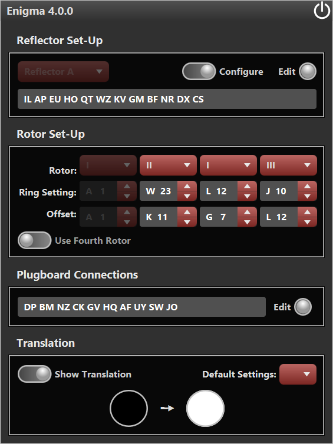
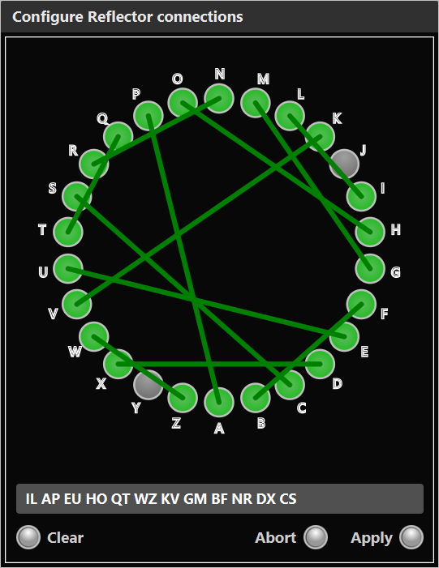
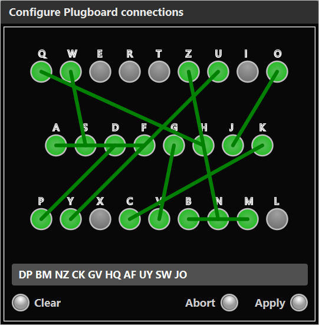

# Enigma4

`Enigma4` is a JavaFX application that simulates the Enigma machine.

**USE AT OWN RISK.**

## Overview
`Enigma4` is a Maven project that uses JavaFX, FXML and CSS to render the GUI. 
Maven can be run from the command line as shown below.
Maven resolves dependencies and builds the application independently of an IDE.

This application simulates the [Enigma Machine](https://en.wikipedia.org/wiki/Enigma_machine). 
Terms such as "ring settings", "stepping", "turnover points" etc. are explained 
here.

**Note:** _there are no restrictions placed on the Rotor selection, as such some 
Rotor combinations can be made that may not be available on the real machine._

**Note:** _the turnover points for the Commercial, Rocket and SwissK Rotors are 
guesses and may be incorrect._

## Dependencies
`Enigma4` is dependent on the following:

  * Java 15.0.1
  * Apache Maven 3.6.3

The source code is structured as a standard Maven project which requires Maven 
and a JDK to be installed. A quick web search will help, alternatively
[Oracle](https://www.java.com/en/download/) and 
[Apache](https://maven.apache.org/install.html) should guide you through the
install.

Also [OpenJFX](https://openjfx.io/openjfx-docs/) can help set up your 
favourite IDE to be JavaFX compatible, however, Maven does not require this.

## Cloning
The following commands clone the `Enigma4` code:

	git clone https://github.com/PhilLockett/Enigma4.git
	cd Enigma4/

## Running
Once cloned the following command executes the `Enigma4` code from within the 
`Enigma4` directory:

	mvn clean javafx:run

If successful `Enigma4` should appear similar to the following:

## User Guide
### General
Settings and states will be persisted from one session to the next.
All settings are saved to `Settings.ser` file on shutdown.
The next time `Enigma4` is executed, these settings are loaded ready to continue 
from where it left off.

### Reflector Set-Up
The `Reflector Set-Up` pane enables either a fixed reflector or a configurable 
reflector to be used depending on the state of the `Configure` toggle switch.
With the `Configure` toggle switch disabled the choice box allows standard 
fixed configuration reflectors to be selected. 

Alternatively, enable the `Configure` toggle switch to use a configurable 
reflector. 
To configure the reflector click the `Edit` button and modify the loop-back 
wired pairs in the `Configure Reflector connections` pop-up window:

Twelve loop-back wired pairs **must** be defined for a valid reflector. 
When twelve wired pairs have be defined click the `Apply` button to save any 
changes and return to the Main window. 

**Note:** _the thirteenth pair is assumed from the two remaining unused 
letters._

### Rotor Set-Up
The `Rotor Set-Up` pane supports configuration of all rotors.

By default, `Enigma4` functions as a 3 Rotor machine, allowing the Left, Middle 
and Right Rotors to be configured.
A Fourth Rotor can be included in the translation if the `Use Fourth Rotor` 
toggle switch is enabled.

There are three steps to setting up a rotor:
  * select the rotor
  * adjust the ring setting
  * select the start position (offset)

#### Rotor Selection
The `Rotor` choice box allows different Rotors to be selected for each of the 
rotor positions.
No restrictions are placed on the selection, so combinations can be selected 
that may not be available on the real machine.

#### Ring Settings
The `Ring Setting` spinners set the ring setting for each corresponding rotor.

#### Rotor Offsets
The rotor `Offset` spinners set up the initial rotor positions. 

The Rotors advance in a predefined orderly manner with each key press before 
translation.

### Plugboard Connections
The `Plugboard Connections` pane shows the current plugboard swap-over pairs.

To configure the plugboard click the `Edit` button and modify the swap-over 
pairs in the `Configure Plugboard connections` pop-up window:

Zero or more swap-over pairs can be configured (typically ten are set). 
When finished click the `Apply` button to save any changes and return to the 
Main window.

### Translation
The `Translation` pane shows the key presses and the translated values using 
the current configuration settings.

#### Show Translation
When the `Show Translation` toggle switch is enabled, all the individual 
translation steps are displayed on the command line.

#### Default Settings
The `Default Settings` choice box allows pre-configured settings to be 
selected from the "Luftwaffe Enigma key list number 649". 
The details of these settings can be found [here](https://en.wikipedia.org/wiki/Enigma_machine#Details). 

Selecting one of these entries will override the: 'Wheel order' (rotor), 'Ring 
settings', 'Plugboard connections', 'Reconfigurable reflector wiring' and the 
'Indicator groups' (using the first indicator group for the rotor offset).

## Points of interest
This code has the following points of interest:

  * `Enigma4` is an updated version of [Enigma3](https://github.com/PhilLockett/Enigma3).
  * `Enigma4` simulates the behaviour of the [Enigma machine](https://en.wikipedia.org/wiki/Enigma_machine).
  * `Enigma4` is a Maven project that uses JavaFX, FXML and CSS.
  * Uses the following custom controllers:
    - "RotorControl", to represent rotor settings.
    - "PairSelect", to represent reflector and plugboard settings.
    - "SwitchControl", to represent a toggle switch.
    - "ButtonControl", to represent a button.
  * Uses subtle linear and radial colour gradients on controls.
  * Uses a custom top-bar on the Main windows.
  * Uses setShape() to create circular text fields.
  * Data is persisted from one session to the next.
  * A `static` Debug object helps control diagnostic output.
  * Rotor combinations can be selected that may not be available on the real machine.
